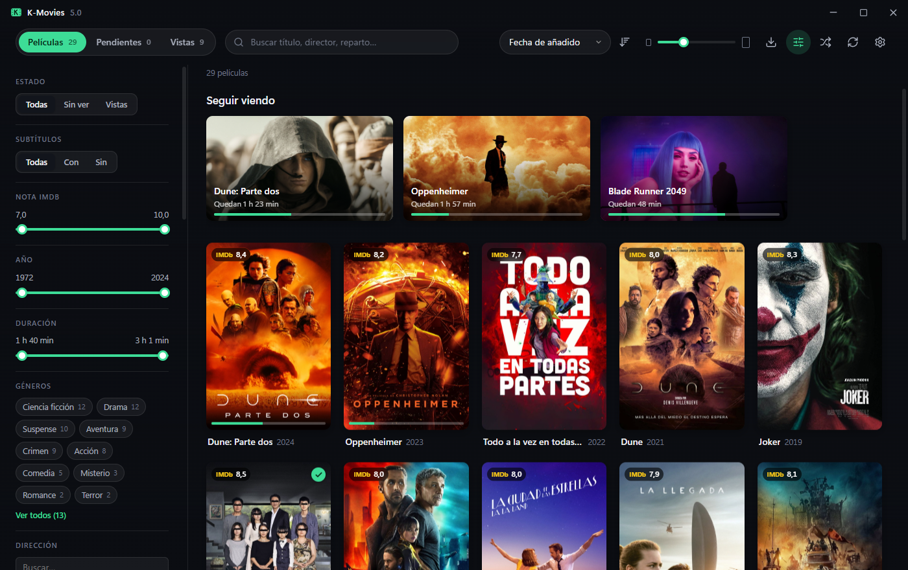

# K-Movies 5.0

Catálogo de películas para Windows. Escanea tus carpetas, identifica cada película con TMDb y la muestra con póster, sinopsis, reparto y notas de IMDb y TMDb. Las reproduce en su propio reproductor (o en VLC), recuerda por dónde ibas y lleva tu historial, que puedes pasar a Letterboxd.



## Qué hace

**Biblioteca**
- Una o varias carpetas (locales o de red). Las películas nuevas, borradas o renombradas aparecen solas.
- Identificación automática con TMDb (por el nombre del archivo, el `.nfo` de Jellyfin/Kodi o un id de IMDb), con corrección manual si se equivoca.
- Rejilla de pósters con tamaño ajustable, fluida con miles de películas.
- Tres listas: **Películas** (en disco), **Pendientes** (las que quieres conseguir) y **Vistas** (tu historial, aunque borres el archivo).
- Búsqueda por título, director o reparto, y filtros combinables: género, año, nota, duración, país, idioma, clasificación, vista o no, y subtítulos.
- Orden por título, fecha de añadido o de estreno, nota de IMDb o TMDb, tu nota, duración, última vez vista o tamaño.
- Ficha con fondo, sinopsis, reparto con fotos, tráiler dentro de la app y página de cada actor o director con sus películas que tienes.
- Importar, copiar y mover archivos con progreso (los subtítulos van con el vídeo) y borrar a la papelera. Arrastrar vídeos a la ventana los importa.

**Reproducción**
- **Reproductor integrado** (mpv): todos los formatos, pistas de audio y subtítulos, retardos y pantalla completa. Se puede dejar siempre encima y hacer pequeño, con controles mínimos.
- Subtítulos a tu gusto: tamaño, altura, letra, color, contorno o caja de fondo, con vista previa en Ajustes. Lo que cambies durante una película se recuerda solo para esa película.
- Idiomas preferidos de audio y subtítulos (por ejemplo: castellano y, si no hay, versión original con subtítulos).
- Continúa donde lo dejaste, fila **Seguir viendo** y marca la película como vista al pasar del 90 % (configurable).
- También funciona con VLC u otro reproductor.

**Letterboxd**
- Exporta tu historial (con fechas, notas y revisionados) en el formato de su importador: solo lo nuevo o todo.
- Importa tu exportación de Letterboxd: vistas, diario, notas y, si quieres, la watchlist a Pendientes.
- Notas propias con estrellas en cada visionado.

**Además:** español e inglés (se pueden añadir idiomas sin recompilar), tema claro u oscuro y película al azar.

## Atajos de teclado

| Dónde | Tecla | Qué hace |
|---|---|---|
| Biblioteca | Flechas · Re Pág / Av Pág · Inicio / Fin | Moverse por los pósters |
| | Intro · P | Abrir la ficha · Reproducir |
| | Ctrl+F o / | Buscar |
| Ficha | P · Esc | Reproducir · Cerrar |
| Reproductor | Espacio o K | Pausa |
| | ← → (con Mayús: 1 min) | Retroceder / avanzar 10 s |
| | ↑ ↓ · M | Volumen · Silenciar |
| | F o Intro · T · Esc | Pantalla completa · Siempre encima · Salir |
| | B · V | Siguiente pista de audio · Siguiente subtítulo |
| | Z · X | Retrasar / adelantar los subtítulos |
| | A · C | Proporción · Recorte (como en VLC) |

## Uso

1. Consigue `K-Movies.exe` (ver [Compilar](#compilar)). Es un solo archivo, sin instalador: cópialo donde quieras y ábrelo. Necesita Windows 10 u 11 con WebView2 (en Windows 11 ya viene).
2. En **Ajustes**, añade tu carpeta de películas y tu clave gratuita de TMDb ([themoviedb.org/settings/api](https://www.themoviedb.org/settings/api)).

Tus datos (biblioteca, ajustes, caché de imágenes y el reproductor) se guardan en `%LOCALAPPDATA%\com.kobayashi82.kmovies`.

## Compilar

Requisitos: [Node.js](https://nodejs.org) 20+, [Rust](https://rustup.rs) y las *Build Tools* de Visual Studio con C++ (ver los [requisitos de Tauri](https://tauri.app/start/prerequisites/)).

```sh
npm install
npm run libmpv         # descarga libmpv-2.dll para el reproductor integrado (una vez)
npm run tauri dev      # desarrollo, con recarga en caliente (o dev.bat)
npm run tauri build    # src-tauri/target/release/K-Movies.exe, con todo dentro
cd src-tauri && cargo test
```

`libmpv-2.dll` va comprimida dentro del ejecutable (ver [src-tauri/lib/README.md](src-tauri/lib/README.md)).

Hecho con [Tauri 2](https://tauri.app), React, TypeScript y Rust; SQLite para los datos y [mpv](https://mpv.io) para el reproductor. Sucesor de K-Movies 4.0 (VB.NET). Las decisiones técnicas y su porqué están en [DECISIONES.md](DECISIONES.md).

## Traducciones

Los textos están en [src/i18n/locales/](src/i18n/locales/). Para añadir un idioma, copia `en.json` con el código del idioma (por ejemplo `fr.json`), cambia `_name` y traduce los valores. También se puede dejar el archivo en `%LOCALAPPDATA%\com.kobayashi82.kmovies\locales\` sin recompilar.

## Créditos

Este producto usa la API de TMDB, pero TMDB no lo respalda ni lo certifica. Las notas de IMDb proceden de los [datasets públicos de IMDb](https://developer.imdb.com/non-commercial-datasets/) (uso personal y no comercial). El reproductor integrado usa [libmpv](https://mpv.io) (compilación de [shinchiro](https://github.com/shinchiro/mpv-winbuild-cmake)).
